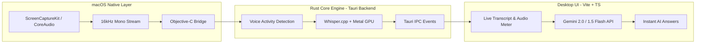

# 🎙️ InterviewBuddy

> **A real-time, stealthy AI interview & meeting copilot for macOS and Windows.**
> Direct system audio capture, local offline GPU-accelerated speech-to-text (Whisper), and intelligent live answer generation powered by Google Gemini.

---

## 🚀 Important: Pushing to GitHub & 12GB Cache
If you notice that your project folder is extremely large (e.g., 12GB+), this is completely normal! Rust caches all compiled C++ AI dependencies in `src-tauri/target/debug/deps`. 
**This massive folder is fully ignored by Git.** 
`.gitignore` is configured to explicitly skip `src-tauri/target/` and `node_modules`. You can safely run `git add .` and `git commit`—none of the 12GB cache will be uploaded to GitHub. 

## ⚡ How to clear cache and get Instant AI Transcription Speed
If Whisper transcription is running very slowly (taking 30+ seconds), you are running the unoptimized Debug build.
**To get instant, blazing-fast transcription on Windows, compile the app in Release mode:**
1. Delete your `src-tauri/target` folder if you need to free up space (optional).
2. Open the **"x64 Native Tools Command Prompt for VS"** (search for this in the Windows Start Menu). *(This prevents the `stdbool.h` compiler crash on Windows).*
3. `cd` into your project directory.
4. Run the optimized build: `npm run tauri dev -- --release`
*(Running with `--release` enables Rust optimizations, shrinking response time from 30 seconds to less than 1 second!)*

---

## 🌟 Overview

**InterviewBuddy** is a lightweight, low-latency desktop assistant designed to listen to live system audio (interviews, lectures, Zoom/Teams/Meet calls, quizzes, or media playback), transcribe the spoken audio in real-time on-device, and provide instant AI-generated answers, explanations, and context-aware insights.

### Key Highlights
- **Direct System Audio Capture**: Captures internal macOS audio directly via Apple's native `ScreenCaptureKit`—**no virtual audio drivers (BlackHole/Loopback) required**.
- **100% Local & Fast STT**: Powered by `whisper.cpp` (`whisper-rs`) with **Apple Silicon Metal GPU acceleration** and custom Voice Activity Detection (VAD).
- **Intelligent Gemini Copilot**: Real-time question detection, multiple-choice quiz solving, interview coaching, and manual on-demand snippets via Google Gemini.
- **Stealth Overlay Window**: Frameless, translucent glassmorphic UI, always-on-top, draggable from any background point, and **invisible to screen-sharing and recordings** (`NSWindowSharingNone`).

---

## 🏗️ Architecture & Tech Stack



### Technology Breakdown

| Component | Technology | Description |
| :--- | :--- | :--- |
| **Desktop Shell** | [Tauri v2](https://v2.tauri.app/) | Secure, ultra-lightweight Rust desktop runtime with native windowing. |
| **Frontend** | TypeScript, Vite, Vanilla CSS | Zero-overhead, high-performance UI with responsive audio visualizers. |
| **System Audio Capture** | Objective-C + ScreenCaptureKit | Native macOS 13+ audio stream loopback with zero virtual cables. |
| **Audio Processing** | Rust + `cpal` | RMS/peak metering, chunking, and rolling buffer segmentation. |
| **Speech-to-Text (STT)** | `whisper-rs` + `whisper.cpp` | Offline automatic speech recognition with Apple Silicon Metal acceleration. |
| **VAD** | Custom Silence/Energy VAD | Filters silence, groups speech bursts, and dispatches to Whisper inference. |
| **LLM & Copilot** | Google Gemini REST API | Live model detection, structured prompt engineering, and auto-answering. |

---

## 📂 Project Structure

```text
interview-buddy/
├── index.html                   # Main application UI layout & modals
├── package.json                 # Node dependencies and build scripts
├── tsconfig.json                # TypeScript compiler configuration
├── vite.config.ts               # Vite configuration (port 1420)
├── src/                         # Frontend application source
│   ├── main.ts                  # UI event handlers, Gemini client, IPC listeners
│   ├── styles.css               # Glassmorphic dark theme styles & animations
│   └── assets/                  # Frontend static assets
└── src-tauri/                   # Rust backend & native code
    ├── Cargo.toml               # Rust crates and target dependencies
    ├── build.rs                 # Native Objective-C compilation bridge
    ├── tauri.conf.json          # Tauri application and window configuration
    ├── native/                  # Native macOS audio capture
    │   ├── macos_audio_capture.h # Objective-C header file
    │   └── macos_audio_capture.m # ScreenCaptureKit stream delegate & resampler
    └── src/
        ├── main.rs              # Tauri entry point
        ├── lib.rs               # Application setup, IPC commands, and background loop
        ├── audio/
        │   ├── mod.rs           # Audio state, RMS & peak calculations
        │   ├── macos.rs         # Safe Rust FFI wrapper for ScreenCaptureKit
        │   └── windows.rs       # Windows audio loopback placeholder
        └── stt/
            ├── mod.rs           # Whisper engine initialization & model management
            └── vad.rs           # Voice Activity Detection (VAD) segmenter
```

---

## 📋 Prerequisites

Before running or developing the project, ensure you have the following installed:

### General
1. **Node.js**: `v18.0.0` or later (LTS recommended).
2. **Rust Toolchain**: Rust 1.77+ with `cargo`:
   ```bash
   # On macOS/Linux
   curl --proto '=https' --tlsv1.2 -sSf https://sh.rustup.rs | sh
   ```
   *(On Windows, download `rustup-init.exe` from [rustup.rs](https://rustup.rs/))*

### macOS Requirements
1. **macOS 13.0+** *(Ventura or later)* for Apple `ScreenCaptureKit` audio APIs.
2. **Xcode Command Line Tools**: `xcode-select --install`
3. **CMake**: `brew install cmake`

### Windows Requirements (Windows 10/11)
1. **Visual Studio Build Tools**: 
   - Download the [Visual Studio Build Tools](https://visualstudio.microsoft.com/visual-cpp-build-tools/).
   - Install the **"Desktop development with C++"** workload (ensure the "Windows 10/11 SDK" optional component is checked).
2. **LLVM (libclang)**: Required by `bindgen` to compile the `whisper.cpp` bindings.
   - Download from [llvm.org](https://releases.llvm.org/download.html) (or use `winget install -e --id LLVM.LLVM`).
   - **Crucial:** Select "Add LLVM to the system PATH" during installation.
3. **CMake**: Install via installer from [cmake.org](https://cmake.org/download/) (or `winget install CMake`).
4. **WebView2**: Windows 11 includes this by default, but Windows 10 users may need to install the [WebView2 Runtime](https://developer.microsoft.com/en-us/microsoft-edge/webview2/).

---

## 🚀 Step-by-Step Setup Guide

### 1. Clone and Install Dependencies

```bash
# Clone the repository
git clone https://github.com/your-username/interview-buddy.git
cd interview-buddy

# Install Node.js frontend dependencies
npm install
```

### 2. OS-Specific Setup & Permissions

#### macOS (ScreenCaptureKit)
Because InterviewBuddy captures system audio using Apple's `ScreenCaptureKit`, macOS requires **Screen & System Audio Recording** permission:
1. On first launch, macOS will prompt you to grant screen recording permissions.
2. If not prompted, go to **System Settings** ➔ **Privacy & Security** ➔ **Screen & System Audio Recording** and toggle **InterviewBuddy** (or your Terminal) **ON**.

*(Note: InterviewBuddy only captures system audio streams; it does not record video).*

#### Windows (WASAPI Loopback)
Windows utilizes CPAL with WASAPI loopback capture natively. 
- No special system permission prompts are required to capture output device audio. 
- **Build Note:** If your first `npm run tauri dev` fails with a `libclang` or `stdbool.h` error, ensure you have correctly installed **LLVM**, **CMake**, and the **Visual Studio C++ Build Tools**, and that you have restarted your terminal to load the updated PATH.

---

### 3. Run in Development Mode

Run the following command in the root directory:

```bash
npm run tauri dev
```

What happens on startup:
1. Vite spins up the frontend at `http://localhost:1420`.
2. Cargo builds the native Objective-C bridge and Rust backend.
3. On first run, the app automatically downloads the `ggml-tiny.en.bin` Whisper model (~75MB) to your local application cache.
4. The transparent overlay window appears on your screen and starts listening to system audio automatically.

---

## 🎯 How to Use

### 1. Configure Gemini AI Key
1. Click the **✦ Set API Key** badge in the titlebar.
2. Paste your Google Gemini API Key ([Get a free key from Google AI Studio](https://aistudio.google.com/app/apikey)).
3. Click **⟳ Detect Models** to fetch all available models for your key (e.g., `gemini-2.0-flash`, `gemini-1.5-flash`).
4. Select your preferred model and click **Save & Connect**. Check *"Remember API key"* if you wish to persist it across restarts.

### 2. Live Audio & Transcription
- Play any audio on your machine (YouTube video, Zoom meeting, Google Meet, audio file, etc.).
- The **audio meter** in the top bar will animate with the audio amplitude.
- Real-time transcriptions will stream into the **Live Transcript** panel.

### 3. Real-Time AI Copilot & Answers
- **Auto-Answer Mode**: When enabled (default), the copilot automatically detects question patterns or multiple-choice formats from the speech and queries Gemini with context.
- **Manual Ask AI**: Click the **✦ Ask AI** button on any individual transcript bubble to generate a targeted answer for that specific text.
- **Copy Transcript**: Click **Copy** in the toolbar to copy the entire timestamped conversation transcript to your clipboard.

### 4. Stealth & Overlay Features
- **Boss Key (Panic Button)**: Press **`Ctrl + Shift + H`** at any time to instantly hide the entire app UI (and mute it) without stopping the background capture. Press it again to reveal the UI.
- **Screen Share Protection**: The window uses native APIs (`NSWindowSharingNone` on macOS, `WDA_EXCLUDEFROMCAPTURE` on Windows) to remain completely invisible to screen capture tools, meeting recordings, and screen sharing sessions.
- **Process & Taskbar Hiding**: The app hides itself from the Windows taskbar and Alt-Tab switcher to evade basic monitoring.
- **Drag Anywhere**: Click and drag any background area of the window to reposition it.

### 5. DSA Coding Mode
- Press **`Ctrl + Shift + C`** or click the **`</>`** button in the AI toolbar to open Coding Mode.
- Select your target language (Python, C++, Java, etc.), paste the problem description, and get a pure code block solution instantly.
- Keeps answers strict, idiomatic, and free of unnecessary prose or explanations.

---

## 🛠️ Building for Production

To build a standalone macOS application (`.dmg` or `.app` bundle):

```bash
npm run tauri build
```

The compiled binary and installer will be located in:
```text
src-tauri/target/release/bundle/dmg/InterviewBuddy_0.1.0_aarch64.dmg
```

---

## 🔍 Troubleshooting & FAQ

### 1. `failed to read plugin permissions... No such file or directory`
If you renamed the project folder, stale Cargo target paths can cause permission read errors. Run:
```bash
cd src-tauri && cargo clean && cd ..
npm run tauri dev
```

### 2. No audio captured or meter stays at 0%
- Check macOS permissions: **System Settings** > **Privacy & Security** > **Screen & System Audio Recording**.
- If permissions were previously revoked, reset them with:
  ```bash
  tccutil reset ScreenCapture
  ```
- Ensure audio is playing through the default system output device.

### 3. Whisper model download issues
The Whisper model is cached in:
- macOS: `~/Library/Application Support/com.qambar.interviewbuddy/models/ggml-tiny.en.bin`
- If the download was interrupted, delete the partial file in that folder and restart the app.

---

## 🤝 Contributing

Contributions are welcome! If you want to improve InterviewBuddy:
1. Fork the Project.
2. Create your Feature Branch (`git checkout -b feature/AmazingFeature`).
3. Commit your Changes (`git commit -m 'Add some AmazingFeature'`).
4. Push to the Branch (`git push origin feature/AmazingFeature`).
5. Open a Pull Request.

---

## 📄 License

Distributed under the MIT License. See `LICENSE` for more information.
