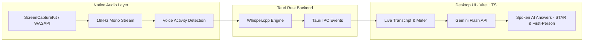

# 🎙️ InterviewBuddy

> **A real-time, stealthy AI interview & meeting copilot for macOS and Windows.**
> Direct system audio capture, local offline GPU-accelerated speech-to-text (Whisper), and intelligent live answer generation powered by Google Gemini.

---

## 🚀 Important: Pushing to GitHub & Cache Management
If you notice that your project folder is large (e.g., 10GB+), this is completely normal! Rust caches all compiled C++ AI dependencies and build objects in `src-tauri/target`. 
- **This entire folder is completely ignored by Git.** 
- `.gitignore` is configured to skip `target/`, `src-tauri/target/`, `node_modules`, and `.env` files.
- You can safely run `git add .` and `git commit`—none of the cache or binary models will be pushed to GitHub.

---

## ⚡ How to Get Blazing-Fast Speech Transcription (< 1s Latency)
If Whisper transcription is running slowly in dev mode, it is because Cargo defaults to an unoptimized debug build.
To get instant, sub-second transcription:
1. Delete the `src-tauri/target` folder if you wish to reclaim disk space.
2. On Windows, open the **"x64 Native Tools Command Prompt for VS"** (search for this in the Windows Start Menu). *(This prevents the `stdbool.h` compiler issue on Windows).*
3. Run the optimized build:
   ```bash
   npm run tauri dev -- --release
   ```
*(Running with `--release` enables full compiler optimizations, slashing transcription latency from 30 seconds to less than 1 second!)*

---

## 🛡️ Screen-Share Stealth & Word Prediction Protection

### 1. Zero Screen-Share Footprint
- **Windows**: Uses native `SetWindowDisplayAffinity(HWND, WDA_EXCLUDEFROMCAPTURE)` to completely exclude the InterviewBuddy window from screen sharing (Zoom, Google Meet, Teams, Discord, OBS).
- **macOS**: Uses `NSWindowSharingNone` to prevent the window from appearing on any screen recording or shared display.
- **Stealth Title & Taskbar**: Automatically disguises the process title and hides itself from the Windows taskbar.

### 2. Disabling the 3-Word Windows Prediction Popup
When typing into input boxes on Windows, the OS feature *"Show text suggestions as I type on the physical keyboard"* may display a floating 3-word predictive pill above your text, which can be visible over screen shares because it is rendered by Windows `TextInputHost.exe`.

InterviewBuddy protects you in two ways:
1. **Built-in Application Protection**:
   - WebView2 is initialized with `--disable-spell-checking --disable-autofill`.
   - All input controls enforce `spellcheck="false"`, `autocomplete="off"`, `autocorrect="off"`, and `data-lpignore="true"`.
2. **System-Wide Disable (Recommended for 100% Stealth)**:
   - Press **`Win + I`** to open Windows Settings.
   - Navigate to **Time & Language** ➔ **Typing**.
   - Under **Physical keyboard**, turn **OFF** the toggle for:
     > **"Show text suggestions when typing on the physical keyboard"**
   - This prevents Windows from ever showing the floating candidate bar over any application during an interview.

---

## 🌟 Key Features

- **Direct System Audio Capture**: Captures internal audio directly via Apple's native `ScreenCaptureKit` on macOS and WASAPI loopback on Windows—**no virtual audio drivers or cables needed**.
- **100% Offline Speech-to-Text**: Powered by `whisper.cpp` (`whisper-rs`) with local VAD (Voice Activity Detection) and anti-hallucination silence filtering.
- **Intelligent Spoken Copilot**: 
  - Answers are written strictly in the **first person ("I", "my")** ready to be read aloud verbatim without meta-commentary or introductory filler.
  - **STAR Method**: Automatically structures behavioral and situational questions (Situation, Task, Action, Result) into natural, conversational storytelling.
  - **Complete Technical Workflows**: Deep multi-step answers (like machine learning lifecycles, database architectures, or coding logic) are fully articulated from start to finish without getting cut off.
- **Resume & Persona Upload**:
  - Upload your resume (`.pdf`, `.txt`, `.md`) or paste your background into the setup modal.
  - Click **Analyze** to have Gemini extract your background so answers naturally reflect your real projects, tools, and achievements.
- **DSA Coding Mode (`Alt + R` / `Ctrl + Shift + C`)**:
  - Modal with instant code generation, multi-screenshot capture, and language support (Python, C++, Java, SQL, TypeScript, Go, Rust, etc.).
- **Manual AI Query Bar**:
  - Type questions directly in the right panel and press `Enter` (or press `/` from anywhere in the window to focus).

---

## 🏗️ Architecture & Tech Stack



---

## 📋 Prerequisites

### General
1. **Node.js**: `v18.0.0` or later (LTS recommended).
2. **Rust Toolchain**: Rust 1.77+ with `cargo` (`rustup-init.exe` on Windows or `curl https://sh.rustup.rs` on macOS).

### macOS Requirements
1. **macOS 13.0+** *(Ventura or later)* for Apple `ScreenCaptureKit` audio APIs.
2. **Xcode Command Line Tools**: `xcode-select --install`
3. **CMake**: `brew install cmake`

### Windows Requirements (Windows 10/11)
1. **Visual Studio Build Tools**: 
   - Install **"Desktop development with C++"** with the **Windows 10/11 SDK**.
2. **LLVM (libclang)**: 
   - Install from [llvm.org](https://releases.llvm.org/download.html) or `winget install -e --id LLVM.LLVM` (make sure to check "Add LLVM to system PATH").
3. **CMake**: `winget install CMake`
4. **WebView2 Runtime**: Included by default in Windows 11.

---

## 🚀 Setup & Launch Steps

### 1. Clone & Install Dependencies
```bash
git clone https://github.com/your-username/interview-buddy.git
cd interview-buddy
npm install
```

### 2. Configure Gemini AI API Key & Resume
1. Launch the app (`npm run tauri dev`).
2. Click **✦ Gemini AI** in the top titlebar.
3. Enter your Gemini API Key ([Get a free key from Google AI Studio](https://aistudio.google.com/app/apikey)).
4. Click **⟳ Detect Models** and choose your preferred model (`gemini-2.0-flash` recommended).
5. (Optional) Upload your resume PDF and click **Analyze** so the AI adopts your real background.
6. Click **Save & Connect**.

### 3. Hotkeys Quick Reference
| Shortcut | Action |
| :--- | :--- |
| **`Alt + R`** | **Boss Key**: Instantly toggle window visibility (hide / show) |
| **`Ctrl + Shift + C`** | Open **DSA Coding Mode** with screenshot solver |
| **`/`** | Quickly focus the **Manual AI Query Bar** |
| **`Enter`** | Submit question in Manual AI Query Bar |
| **`Escape`** | Blur/unfocus the query bar |

---

## 📦 Download & Install (End Users)

No development tools needed! Just download the installer for your platform:

| Platform | Format | File |
|----------|--------|------|
| **Windows 10/11** | NSIS Installer | `InterviewBuddy_0.1.0_x64-setup.exe` |
| **macOS (Intel)** | DMG | `InterviewBuddy_0.1.0_x64.dmg` |
| **macOS (Apple Silicon)** | DMG | `InterviewBuddy_0.1.0_aarch64.dmg` |

Download the latest release from the [Releases](../../releases) page.

> **Note:** On first launch, Interview Buddy will automatically download the Whisper speech model (~75MB). This is a one-time download.

---

## 🛠️ Building for Production (Developers)

To generate optimized installers from source:

```bash
# 1. Install dependencies
npm install

# 2. Build the installer
npm run tauri build
```

The output installers will be created inside `src-tauri/target/release/bundle/`:
- **Windows**: `src-tauri/target/release/bundle/nsis/InterviewBuddy_0.1.0_x64-setup.exe`
- **macOS**: `src-tauri/target/release/bundle/dmg/InterviewBuddy_0.1.0_x64.dmg`

### Automated Releases (CI/CD)
Push a version tag to trigger automated builds via GitHub Actions:
```bash
git tag v0.1.0
git push origin v0.1.0
```
This builds Windows + macOS installers and publishes them as a GitHub Release draft.

---

## 📄 License
Distributed under the MIT License. See `LICENSE` for more information.
